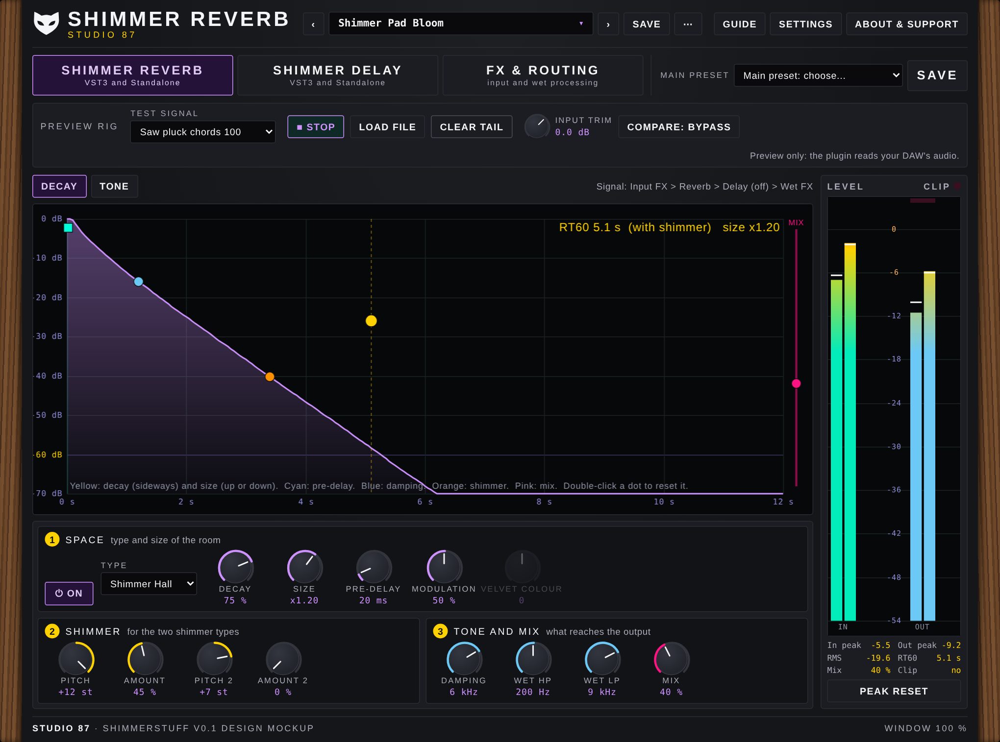

# shimmerstuff

Shimmer reverb, shimmer delay, input and wet FX and a routing view in one plugin, by Studio 87 (VST3 + Standalone, Linux/Windows/macOS).

Reverb types: plate, hall, shimmer plate, shimmer hall, velvet. DSP is header-only (`src/Reverb.h`, `src/Fx.h`) with unit tests.

Status: pre-release 0.1.0. Every knob is automatable. The routing graph is saved with presets and projects but is not an automatable parameter. The Decay view measures a private copy of the reverb. The duck sources "rig kick" from the mockup are not in the plugin (plugin input and sidechain input are). Not yet auditioned by ear.

    sh tests/run.sh

 Screenshot of the interactive mockup in docs/mockups.

**Manual:** [PDF, opens in the browser](https://github.com/SpeakingColors/shimmerstuff/blob/main/docs/shimmerstuff-manual.pdf)

## Support

  

☕ Free and open source, made by one person. If it helps your music, a coffee on [Ko-fi](https://ko-fi.com/studio87) keeps it coming. 💜

## Design mockup

An interactive mockup of both plugins is in [docs/mockup/shimmerstuff.html](docs/mockup/shimmerstuff.html). Download it and open it in a browser. It runs a port of the plugin DSP, so it sounds like the real thing.
